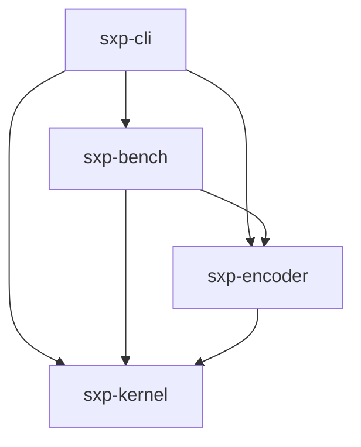
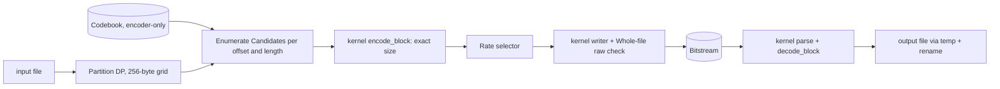

# Architecture Spine — SerExpAI v1

SerExpAI is the product. MBSC (Multi-Basis Series Compression System) is the idea it represents. Cargo crates use the prefix `sxp-`.

## Design Paradigm

**Normative Kernel + Encoder Shell.** The decoder is a small normative kernel that must be bit-exact on every platform. The encoder is an exploratory search wrapped around that kernel and is free to change without touching the format. Encoder-side code depends on the kernel, never the reverse. The rule is enforced by the Cargo crate graph, not by convention.

| Crate (`crates/`) | Layer | Owns |
| --- | --- | --- |
| `sxp-kernel` | Normative kernel | Normative Evaluator, sine LUT, modular residual math, Probability model, binary range coder, Block encode/decode, all Bitstream read and write primitives |
| `sxp-encoder` | Encoder side | Codebook, Baselines, Candidate enumeration, Block partition DP, Rate selector |
| `sxp-bench` | Shell | Corpus manifest, synthetic signals, benchmark arms, report |
| `sxp-cli` | Shell | `compress`, `decompress`, `benchmark` subcommands |



## Invariants & Rules

### AD-1 — Kernel isolation

- **Binds:** all
- **Prevents:** the decoder reaching the Codebook, the search or any third-party coder, and normative behaviour drifting with a dependency upgrade.
- **Rule:** `sxp-kernel` has zero third-party runtime dependencies and `#![forbid(unsafe_code)]`. It imports nothing from `sxp-encoder`, `sxp-bench` or `sxp-cli`. The decode path is `sxp-cli -> sxp-kernel` only. CI fails if `cargo tree -p sxp-kernel -e normal` lists any external crate (dev-dependencies such as proptest are allowed).

### AD-2 — One coding path for every Candidate

- **Binds:** FR-5, FR-6, FR-7, FR-14, SM-1
- **Prevents:** a Baseline and a Formula being measured through different framing or models, which would make Gain unattributable.
- **Rule:** Formula, constant, previous-byte, direct entropy coding and Raw Block are all Candidates of one kernel `encode_block` function. A Candidate differs only in how its ŷ stream is produced (a Raw Block skips prediction and the coder stream). The encoder never estimates a Candidate's size; it asks the kernel for the exact size of the Block it would write.

### AD-3 — Modular residual reconstruction

- **Binds:** FR-1, SM-2
- **Prevents:** a Predictor needing correctness proofs, or two code paths for residual arithmetic.
- **Rule:** The residual is `δ = ((y − ŷ + 128) mod 256) − 128`, reconstruction is `y = (ŷ + δ) mod 256`, and the coded symbol is `δ mod 256` as a byte. The same two functions in the kernel serve encoder and decoder. Under direct entropy coding the coded symbol is the byte itself.

### AD-4 — Formulas are positionwise

- **Binds:** FR-3, FR-4, FR-5, FR-7
- **Prevents:** history-dependent predictors that would make Block cost depend on how a Block was reached, and any cross-Block state.
- **Rule:** A Formula's ŷₙ depends only on Block-local position `n` (0 at each Block start) and the Formula's own parameters. Previous-byte prediction is the only Candidate that reads decoded bytes; it reads only within its Block and predicts 0 for the first byte. Constant prediction carries one per-Block constant byte.

### AD-5 — Single Normative Evaluator, overflow impossible by construction

- **Binds:** FR-2, FR-3, SM-2, SM-5
- **Prevents:** encoder and decoder computing ŷ with different code, platform-dependent overflow, rounding or shift behaviour, and two readings of "normalized position".
- **Rule:** The evaluator lives only in `sxp-kernel`, and the encoder calls the same routine. All intermediates are signed 64-bit integers. The position input is `u = n << 5` (a fixed 16-bit position, always scaled by the maximum Block length 2048, never by the actual Block length). The polynomial is defined by this exact recurrence: `acc ← c_d`, then for k = d−1 down to 0, `acc ← ((acc · u) >> 16) + c_k`, then the result is `(acc + (1 << (Q−1))) >> Q`. Every shift is an arithmetic (floor) shift. With |c| < 2³¹ and degree at most 15 every intermediate stays below 2⁵². Every other family has a normative limit table chosen so every intermediate stays below 2⁶² (for example recurrence |a|, |b|, |c| < 2²⁴ and 1 < `m_mod` ≤ 2²⁴). ŷ is the final value reduced by `rem_euclid(256)`. Q is per Polynomial and Trigonometric Formula in [8, 24], stored as `Q − 8` in 5 bits. Halfway cases round toward +∞ for negative values too, and the evaluator uses no division other than `rem_euclid`. A stored value outside its range is an error, never clamped. The decoder rejects any parameter outside its limit, and uses no floating point. The sine LUT's values are normative data (published with a hash); how they were generated is not. The spec carries a boundary vector and a rejection vector for every limit, and a vector for a negative halfway case.

### AD-6 — Family-specific parameter layouts

- **Binds:** FR-3, FR-9
- **Prevents:** one overloaded "M" meaning degree, order and modulus, and fields too narrow for their ranges.
- **Rule:** Each Series family has its own named layout. Polynomial stores degree and has degree + 1 coefficients. Trigonometric stores order M, has 2M + 1 coefficients, and adds one base-frequency phase increment. Recurrence is one family with an order field (1 or 2), initial values and `m_mod`. Every count field uses a stated offset encoding (for example `stored = count − 1`). Family limits are independent. Signed fields are two's complement.

### AD-7 — One causal Probability model, hand-written binary coder

- **Binds:** FR-6, FR-7, FR-8
- **Prevents:** a Candidate-specific or non-causal model, a model chosen from the symbol being decoded, the spec depending on a third-party coder's internals, a coder whose state interval is not invertible for the totals it is given, and decoder structures that read on Microsoft US 11,234,023 B2.
- **Rule:** The model is adaptive order-0. Each symbol is coded as 8 binary decisions, most significant bit first, through a 255-node bit tree. Every node holds a 16-bit probability `p` = P(0)·65536 and a saturating occurrence count `n` that selects an integer update rate `R = RECIP[n]` from a normative table with entries in [1, 65535]. The update uses non-negative operands in both directions (on 0, `p += ((65536 − p)·R) >> 16`; on 1, `p −= (p·R) >> 16`), defined in u32 or i64 (every product is below 2³², so i32 arithmetic and signed 32-bit shifts are forbidden), which keeps `p` in [1, 65535] with no clamp. The initial `p` lies in [16, 65520] and is one scalar or an 8-entry per-depth table shared by every Candidate. The decoder rebuilds all nodes from already-decoded symbols, nothing is transmitted, and the model resets at every Block start. The coder total is the fixed constant 4096 for every decision; the coder frequency is `freq0 = max(p >> 4, 1)` and `freq1 = 4096 − freq0`, both in [1, 4095]. (The earlier 12-bit signed update stalled P(0) at 4070/4096 and made a perfectly predicted 2048-byte Block cost 22.2 bytes instead of 5.3.) The initial probability, the RECIP table and the count cap are constants frozen in the spec, tuned on `tuning` inputs only and scored on the Baselines-only arm, so they cannot favour Formula residuals; ties go to the simpler setting.

The coder is a hand-written LZMA-style binary range coder (spec seed §6.1: 32-bit range, carry via cache, decisions encoded in forward order, 4-byte flush per Block), kept behind one kernel interface (encode decisions, decode decisions, exact size). The coder is not signalled in the stream. A byte-wise rANS coder with the same measured overhead is kept as informative Appendix A of the seed; adopting it in a later format requires a freedom-to-operate review of Microsoft US 11,234,023 B2 and its family and a version bump. As safeguards against that patent family's claims, every MBSC decoder follows the seed's reference decode procedure: per decision it takes `freq0`, decides the bit, updates the state for that bit, refills until the state is back in range, then updates the model, with no deferred update, no pending-symbol state and no test that gates whether a decision is decoded. No coder state crosses a Block boundary, and the format has no field choosing to flush or retain coder state. Interleaved or SIMD coding, hardware pipelining and context modelling are not used. No coder crate is in the normative path.

### AD-8 — Blocks are self-contained and additive

- **Binds:** FR-5, FR-6, FR-9, FR-14
- **Prevents:** Block cost depending on neighbouring Blocks, which would make partition search and per-Block Candidate costs inexact, and two owners of the serialisation code.
- **Rule:** Each Block is byte-aligned. A coded Block consists of its header, its parameters and its own coder stream with its own termination. A Raw Block is its header followed by the Block's bytes verbatim. Model state resets at Block start. Payload length is not stored; the decoder consumes exactly the bytes decoding the Block's symbol count requires. The total size of a file is the sum of its Blocks' sizes plus the file header and the 4-byte CRC trailer. All Bitstream read and write primitives, including the file header and Block headers, live only in `sxp-kernel`; `sxp-encoder` composes them and never serialises a field itself.

### AD-9 — Partition by free dynamic programming on a 256-byte grid

- **Binds:** FR-5, FR-6, FR-14
- **Prevents:** ad-hoc or greedy partitioning, differing partition rules between arms, and unsignalled partial Blocks.
- **Rule:** Blocks are a plain sequence, each with a 2-bit length code over {256, 1024, 2048, reserved}. The encoder runs a one-dimensional DP over every 256-aligned offset using exact Block sizes. At offset `o` with `r = N − o` bytes left, the allowed transitions are every nominal length `L ≤ r` (a full Block), and, when `r ≤ 2048`, the single smallest nominal length `≥ r` (a final Block). The actual length of a Block is `min(nominal, r)`. A nominal length is canonical only if it is one of those transitions; the decoder rejects a non-canonical nominal length and the reserved code. The Baselines-only arm and fixed-length benchmark runs use the same DP with their own allowed length set A, applied independently: full transitions are the lengths in A that are `≤ r`; a final transition is allowed only when `r ≤ max(A)` and is always coded with the canonical nominal, the smallest length in {256, 1024, 2048} that is `≥ r`, so every run decodes through the same kernel.

### AD-10 — Rate selector on exact size, bounded raw fallback

- **Binds:** FR-6, FR-10, SM-3
- **Prevents:** selection on an estimate, ties resolved by scheduling or by which Candidate happens to enumerate first, and unbounded expansion.
- **Rule:** The DP minimises the key `(total size, Block count, lexicographic sequence of (length code, Candidate id))`. Candidate ids are independent of the wire kind codes and order Raw = 0, Direct = 1, Previous-byte = 2, Constant with byte `c` = 3 + `c` (the encoder evaluates all 256 constants), then Formulas from 259 by family and Codebook index, so ties never favour a Formula over a Baseline, never depend on scheduling, and a Raw Block wins any tie. A Raw Block is chosen unless the alternative is strictly smaller, with framing counted on both sides. The encoder also compares the whole Blocked output with Whole-file raw; Whole-file raw wins ties and the empty input. The output is at most N + 11 bytes for every input (format versions 1–14). No entropy screen or other heuristic may change which Candidate wins, so `compress` and the full-MBSC `benchmark` arm produce identical bytes. Exact speed-ups are allowed: precomputed ŷ tables per Formula, one model probability sequence shared across Block lengths at an offset (coder encode stays per Candidate and length), skipping a Candidate whose header and parameter bytes alone reach the incumbent's exact size, and reciprocal-table division. A lower-bound prune on coder size is allowed only once a written proof shows it is admissible.

### AD-11 — Container framing and spec obligations

- **Binds:** FR-9, FR-10, FR-11
- **Prevents:** ambiguous framing, unversioned streams, two decoders disagreeing on field packing or on what to reject.
- **Rule:** The file header is one magic byte (`0x8D`), one byte of format version (4 bits; v1 = 1, 0 invalid, 15 reserved for extension) and mode, then N as LEB128 with N < 2³⁵ (at most 5 bytes). Modes are Blocked and Whole-file raw. Every file, in both modes, ends with a mandatory 4-byte `LE32(CRC-32/ISO-HDLC)` of the decoded bytes; framing alone cannot detect corruption of Formula parameters, kind codes or Raw Blocks. Multibyte integers are little-endian. Packed fields are fixed-width and fill each byte from the least significant bit first; padding bits are zero and checked. A decoder rejects: version 0, 15 or any unknown version, a set reserved bit, a non-minimal LEB128, any byte after the CRC, a stream that ends before N bytes are decoded or before the CRC, a CRC mismatch, and a coder stream whose initial `code` is `0xFFFFFFFF` or whose final `code` is not 0. `compress` refuses an input with N ≥ 2³⁵. The empty input is the 3-byte Whole-file raw header plus the CRC of no bytes (7 bytes); Blocked mode with N = 0 is rejected. The spec must define, before implementation of the kernel starts: magic and version/mode packing, the Block header and kind codes, each family's layout and limit table, the Raw Block layout, range-coder initialization and termination, the CRC trailer, the model constants and RECIP table, the LUT, the canonical-length constraints of AD-9 (normative), and the v1 partition DP with its tie key (informative, since any encoder may choose a different valid partition).

### AD-12 — Decoder and encoder safety, bounded memory

- **Binds:** FR-12, FR-13, SM-2
- **Prevents:** out-of-bounds reads, allocations driven by an untrusted declared length, and valid-looking partial output.
- **Rule:** The kernel's parsing and decoding entry points return `Result` and cannot panic on any byte sequence; `clippy::unwrap_used`, `clippy::panic` and `clippy::indexing_slicing` are denied in the kernel. The decoder works one Block at a time with a heap working set of at most 64 KiB, independent of N, asserted by a test using a counting allocator. `compress` and `decompress` both write a temporary file in the target directory and rename it on success. Truncated, mutated or malformed input exits non-zero with a message and leaves no output file. A mutation test over valid streams runs through the kernel and the Python reference decoder.

### AD-13 — Deterministic encoder under parallelism, reproducible Codebook

- **Binds:** FR-4, FR-12, SM-4, SM-C2
- **Prevents:** output depending on thread count or scheduling, a Codebook that cannot be regenerated on another platform, and tuning-set leakage.
- **Rule:** The encoder may parallelise Candidate and offset evaluation. Every reduction uses the key of AD-10, and output is byte-identical to a single-threaded run, with a test asserting it. The Codebook is generated by a documented deterministic recipe using integer arithmetic only, holds at most 4096 Formulas in total and at most 2048 per family, includes all three families, and carries a version and a content hash. It is tuned only on `tuning` inputs and records their content hashes. The decoder never reads it.

### AD-14 — Benchmark integrity

- **Binds:** FR-14, FR-15, SM-1, SM-4, SM-C1, SM-C2
- **Prevents:** a verdict inflated by tuning-set leakage or synthetic signals, arms that differ in more than the Predictor, and sizes measured anywhere other than on the real stream.
- **Rule:** Total encoded size is the byte length of the real Bitstream. Every benchmark round-trip is verified by decoding through the `sxp-kernel` decode path; a mismatch fails the run. Each arm uses the AD-9 DP, the AD-10 key and the Whole-file raw check, and differs only in its Candidate set:

  | Arm | Candidate set |
  | --- | --- |
  | Whole-file raw | none (header + N bytes + CRC) |
  | Forced Constant / Previous-byte / Direct | that Baseline + Raw Block |
  | Baselines-only | all three Baselines + Raw Block |
  | Full MBSC | everything in the Codebook + Baselines + Raw Block |

  The best whole-input Baseline is the smallest of the three forced arms per input. Gain for a Real input class means the summed size of full MBSC is smaller than both the summed Baselines-only size and the summed best-whole-input-Baseline size. The verdict is positive if at least two Real input classes show Gain on `evaluation` inputs, inconclusive if fewer than two Real classes could be tested, and negative otherwise. The report also gives per-input wins and the margin, and keeps synthetic signals in a separate section. It states the size breakdown (header, parameter, coder payload, coder flush), the adaptation overhead (the ideal adaptive code length, the sum of `−log2(freq/4096)` over the Block's decisions, minus the Block's zero-order entropy, with the coder flush reported separately), the share of Blocks and bytes won by each family and Baseline, and the zero-residual share per class. It records the Codebook version and hash, Block lengths, tool version, Corpus manifest hash and the tuning-input hashes, and asserts that no tuning input shares a contiguous run of K bytes or more (K = 1 KiB, proposed) with any evaluation input; distinct hashes alone do not suffice. A corpus-side transform (such as the 16-to-8-bit PCM derivation) is corpus preparation done by the fetch tool, versioned, with source and derived hashes in the manifest; the compressor sees bytes only. The report gives a deterministic work count per arm (model decisions and coder steps per input byte) and holds no wall-clock or host-dependent values; those go to a separate timing log excluded from determinism checks. A full benchmark run is budgeted at 24 h on one named host; if missed, shrink the corpus first, then lower the Codebook cap and report the excess bytes from the sidecar. Synthetic signals are generated by integer-only code from a documented seed. `benchmark` also writes a sidecar of the exact size of every evaluated Candidate for each Block (`u16` matrix indexed by offset, length code and Candidate id, with the layout documented) so a later index can be validated for recall and excess bytes. The sidecar is written by default for inputs up to 4 MiB (about 100 bytes per input byte) and opt-in above that; the report states which inputs have one.

### AD-15 — Normative change forces a version bump

- **Binds:** FR-2, FR-9, FR-11, SM-5
- **Prevents:** the spec, the kernel, the golden vectors and the reference decoder silently diverging.
- **Rule:** Any change to the Evaluator, sine LUT, RECIP table, model constants, coder, CRC trailer or Bitstream layout bumps the format version and regenerates the golden vectors in `spec/vectors/` in the same change. A Codebook change does not bump the format version. An in-repo Python reference decoder (standard library only), written from the spec and not translated from the Rust, decodes the golden vectors on x86-64 and aarch64 alongside the Rust kernel. Before spec freeze this agreement runs in CI but does not block the benchmark; it is required to be green at spec freeze and before any public release. The Python decoder shares its author's reading of the spec, so it does not satisfy SM-5 alone. The SM-5 gate is a clean-room decoder written only from `spec/bitstream.md`, the LUT, the RECIP table and the vectors, by a different person or a fresh sandboxed AI agent of a different model family (prompt and model ID recorded), in a language other than Rust or Python, logging every ambiguity as a spec issue. It runs at spec freeze, before first public release and on every format version bump. CI also runs a valid-stream generator with three-way differential fuzzing (kernel, Python, clean-room): all decode identically or all reject.

## Consistency Conventions

| Concern | Convention |
| --- | --- |
| Naming | Crates `mbsc-<layer>`. Format terms (Block, Formula, Candidate, Residual, Codebook) match the PRD Glossary exactly in code, spec and report. Family fields use the AD-6 names (`degree`, `order`, `m_mod`, `q`). |
| Data & formats | Little-endian integers, LSB-first bit packing, byte-aligned Blocks. Sizes are bytes, Rate is bits per input byte, and a ratio is only written `S_total / (8N)`. Manifest and reports are TOML in, JSON out. |
| State & cross-cutting | No global mutable state. Kernel functions are pure and take explicit inputs. Errors are typed `Result`s with plain error enums; only the shell adds context strings. CLI exits 0 on success and 1 on any error with a message on stderr. No logging framework and no config files; the benchmark report goes to stdout and a JSON file. |
| Verification | Property tests for AD-3 and for Rate-selector minimality; golden, boundary and rejection vectors and the Python reference decoder per AD-5 and AD-15; round-trip of the empty, shorter-than-one-Block, exactly-one-Block and partial-final-Block inputs; truncation, mutation, CRC-mismatch and trailing-byte rejection per AD-11 and AD-12; a determinism test per AD-13; a no-expansion test (N + 11) for FR-10 on random and already-compressed inputs; a corpus overlap check per AD-14; valid-stream generation and differential fuzzing per AD-15. |

## Stack

| Name | Version |
| --- | --- |
| Rust (stable), edition | 1.99.1, 2024 |
| rayon (`sxp-encoder`) | 1.12.0 |
| clap (`sxp-cli`) | 4.6.7 |
| serde, serde_json, toml, sha2 (`sxp-bench`) | 1.0.229, 1.0.154, 1.1.8, 0.11.1 |
| proptest (dev) | 1.12.0 |
| Python (reference decoder and fetch tool, stdlib only) | 3.14 (at least 3.14.4; 3.14.10 current) |
| Target platforms | x86_64-unknown-linux-gnu, aarch64-unknown-linux-gnu |

## Structural Seed

Compress and decompress flow. The Rate selector and DP sit encoder-side, and the decode path touches only the kernel:



### Environments & Operations

- **Deployment:** a local CLI only, built with `cargo build --release` and distributed as source in v1. There is no service and no runtime network access except the corpus fetch tool.
- **Reproducibility:** `rust-toolchain.toml` pins 1.99.1 and `Cargo.lock` is committed, because SM-4 needs identical sizes on a clean checkout.
- **CI contract:** one local script (`ci.sh`) runs `cargo fmt --check`, `cargo clippy -D warnings`, the tests, the kernel dependency check, the golden vectors in Rust and in the Python reference decoder. It runs on x86-64 and on aarch64 (native runner or qemu-user). The CI host is not chosen.
- **Corpus fetch:** `tools/fetch/` is a Python standard-library script that downloads and verifies the manifest's SHA-256 values. Nothing is vendored.

```text
serexpai/
  Cargo.toml            # workspace
  Cargo.lock
  rust-toolchain.toml
  ci.sh
  crates/
    sxp-kernel/        # normative; zero third-party runtime deps
    sxp-encoder/
    sxp-bench/
    sxp-cli/
  spec/
    bitstream.md        # normative spec (FR-11)
    sine_lut.*          # normative LUT data + hash
    vectors/            # golden, boundary and rejection vectors
  tools/
    refdec/             # Python reference decoder (stdlib only)
    fetch/              # hash-verified corpus fetch
  corpora/
    manifest.toml       # name, class, source, licence, sha256, role
```

## Capability → Architecture Map

| Capability / Area | Lives in | Governed by |
| --- | --- | --- |
| FR-1 Modular residual | `sxp-kernel` | AD-3 |
| FR-2, FR-3 Evaluator and layouts | `sxp-kernel` | AD-5, AD-6, AD-15 |
| FR-4 Codebook | `sxp-encoder` | AD-13 |
| FR-5 Per-Block search, FR-6 Rate selector | `sxp-encoder` | AD-2, AD-9, AD-10 |
| FR-7 Baselines | `sxp-encoder` (kernel `encode_block`) | AD-2, AD-4, AD-14 |
| FR-8 Probability model and binary coder | `sxp-kernel` | AD-7, AD-8 |
| FR-9, FR-10 Bitstream, raw fallback | `sxp-kernel` | AD-8, AD-10, AD-11 |
| FR-11 Spec document | `spec/` | AD-11, AD-15 |
| FR-12, FR-13 `compress`, `decompress` | `sxp-cli` | AD-12, AD-13 |
| FR-14, FR-15 `benchmark`, manifest | `sxp-bench` | AD-14 |

## Deferred

| Item | Why it can wait | Revisit |
| --- | --- | --- |
| Corpus details (OQ4) | Inputs, slices, sampling and overlap policy fixed (spec companion `corpora.md`); open: confirm LJ Speech prefix range and seed, overlap threshold K | Before first benchmark run |
| Probability-model constants | Structure and tuning procedure fixed (AD-7); CAP in {24, 32, 60, 128, 255}, RECIP schedule (DELTA 0.5 or 1), initial `p` (scalar or 8-entry per-depth) measured on `tuning` inputs via the Baselines-only arm | Before first spec freeze |
| Licence and contribution model (OQ5) | Decided: code and Python decoder MIT OR Apache-2.0, spec CC BY 4.0 (OWFa 1.0 optional), vectors, LUT and RECIP CC0, DCO with no CLA; to be committed as files | Before first public release |
| rANS coder (seed Appendix A) | Format v1 uses the range coder; rANS gives no rate gain (prototype: 29.3 against 28.3 bits of excess per Block) and would need a freedom-to-operate review of US 11,234,023 B2 (claim chart: `../../research/rans-patent-claim-chart-2026-10-31.md`) plus a format version bump | Only if a later version needs rANS's decode speed |
| Legal review before first public release | The rANS patent no longer applies to v1. A permissive licence cannot grant rights to third-party patents, so the review precedes any public release. Counsel still reviews the §5 adaptive probability update against the live adaptive-coding patents the claim chart found (Qualcomm US 10,554,988 and US 10,148,961; Tencent US 12,348,780), plus general clearance | Before first public release |
| Lower-bound pruning | Empirical bound `exact ≥ ceil((ideal + 23)/8)` is unproven (AD-10) | If encode time misses the 24 h budget |
| Entropy screen | v1 chooses fidelity over speed (SM-C3); a later screen must keep `compress` and `benchmark` identical | If encode time blocks use |
| Global coder stream, minimal flush | Costs a few bytes per Block; upgrade via version bump. Bloom's minimal flush on its own raises no new patent question, but letting coder state cross Blocks or adding a flush/retain field needs a new freedom-to-operate review first (continuation US 2022/0109891 A1 claims such a field) | If measurement shows flush dominates |
| Local parameter fitting (OQ1), Chebyshev family, format-aware preprocessing, context-adaptive model | Out of v1 scope (PRD §5) | After a rate result exists |
| Candidate-retrieval index | Only meaningful if exhaustive search shows Gain; must first be validated against the AD-14 cost sidecar for recall and excess bytes | After a positive SM-1 |
| Stable library API | Not promised in v1; the crate split does not close it off | Before any embedding use |
| CI provider | The CI contract is fixed; the host is not | When the repository gets a remote |
